# Arquitetura em camadas

O pipeline atual integra três fontes: estoque mensal da UnB, catálogo CATMAT e
preços de compras públicas. Os coletores gravam as respostas em JSONB na camada
`raw`; dbt transforma esses documentos em tabelas Bronze e Prata; o processo de
correspondência usa o schema técnico `busca` e grava candidatos e decisões na
Prata; por fim, o dbt materializa o modelo analítico na Ouro.

O schema `busca` é infraestrutura de recuperação de correspondências. Ele não
é a camada semântica analítica de consumo que poderá existir depois da Ouro.

## Fluxo completo

```mermaid
flowchart LR
    E[API de estoque da UnB] --> I[Coletor Python]
    C[API do CATMAT] --> I
    I --> R[(raw.estoque<br/>raw.catmat)]

    R --> B[dbt: Bronze<br/>estoque e CATMAT tabulares]
    B --> N[Python: normaliza descrições<br/>distintas de bronze.estoque]
    N --> CSV[seeds/materiais_normalizados.csv<br/>versionado no repositório]
    CSV --> S[dbt seed<br/>bronze.materiais_normalizados]
    B --> P[dbt: Prata<br/>material, estoque, almoxarifado<br/>e hierarquia CATMAT]
    S --> P

    P --> M[semantica<br/>sincroniza descrições e vetoriza]
    M --> Q[(busca<br/>descrições, embeddings,<br/>modelo e execuções)]
    M --> PC[(prata.candidato_catmat<br/>prata.revisao_*)]
    PC --> A[prata.v_item_aprovado]

    A --> API[API de pesquisa de preços<br/>Compras.gov.br]
    API --> RC[(raw.compras<br/>raw.compras_coleta)]
    RC --> BC[dbt: Bronze e Prata<br/>compras_bronze<br/>compra_publica]

    P --> O[dbt snapshot + Ouro]
    PC --> O
    BC --> O
    O --> OU[(ouro.dim_*<br/>ouro.fato_comparacao_preco<br/>ouro.monitor_atualizacao)]
```



## O que cada área guarda

| Área | Conteúdo | Como é produzida |
|---|---|---|
| `raw` | Payloads JSONB originais e hashes de estoque, CATMAT e compras | Coletores Python consultam as APIs e inserem diretamente no PostgreSQL |
| `bronze` | Estoque e CATMAT expandidos e tipados; compras expandidas quando a etapa de compras é executada; seeds de normalização e exceções de qualidade | `dbt build` usa modelos SQL e os CSVs de `seeds/` |
| `prata` | Materiais identificados, estoque relacionado, hierarquia CATMAT, preços públicos, candidatos e revisões | Modelos dbt e serviço de correspondência |
| `busca` | Descrições indexadas, vetores, modelo usado e execuções da busca | Serviço Python `semantica` |
| `ouro` | Dimensões, snapshot da correspondência, fato de comparação de preços e monitor de atualização | `transformar_ouro` executa dbt depois da coleta de compras |

### Raw e Bronze

O serviço `ingest` inicializa o esquema raw e chama os coletores do estoque da
UnB e do CATMAT. Cada payload é validado em memória e gravado como JSONB; o
SHA-256 torna a inserção idempotente. Não há arquivos de dados locais como
etapa intermediária.

Os modelos `bronze.estoque` e `bronze.catmat` expandem os arrays JSONB, convertem
os campos tipados e mantêm o hash de origem. Cada item CATMAT vira uma linha em
`bronze.catmat`; cada registro de estoque conserva mês e ano da publicação.

### Normalização e seed

As regras compartilhadas ficam em `codigos/normalizar/limpeza.py`. O comando
`python -m codigos.normalizar` lê as descrições distintas de
`bronze.estoque`, aplica essas regras e grava o mapeamento original →
normalizado em `seeds/materiais_normalizados.csv`. Esse CSV é versionado no
repositório e o dbt o carrega em `bronze.materiais_normalizados`.

O CSV **não vai para `raw`**. Ele é um seed do dbt na Bronze. A Prata usa o seed
para criar `prata.material` e relacionar as linhas de `prata.estoque` com o
material normalizado. `seeds/excecoes_qualidade.csv` também é carregado na
Bronze e fornece exceções revisadas para os testes de qualidade.

Há uma etapa operacional que precisa ficar explícita: o Compose executa
`dbt build`, mas não chama `python -m codigos.normalizar`. Portanto, se uma
nova carga Bronze trouxer descrições que ainda não estão no CSV, é necessário
regenerar o seed antes de reconstruir os modelos Prata. O seed atual tem 2.327
descrições; `prata.material` tem 2.306 materiais válidos.

### Prata e correspondência CATMAT

O dbt cria `prata.material`, `prata.almoxarifado`, `prata.estoque` e as tabelas
da hierarquia CATMAT (`catmat_grupo`, `catmat_classe`, `catmat_pdm` e
`catmat_item`). As fontes semânticas são `prata.material` e `prata.catmat_item`.

O serviço `semantica` mantém no schema `busca` os textos originais e
normalizados, embeddings pgvector, metadados do modelo e histórico de execução.
Depois da busca, os candidatos e revisões ficam na Prata:
`prata.candidato_catmat`, `prata.revisao_correspondencia` e
`prata.revisao_material`. As views `prata.v_candidato_catmat`,
`prata.v_fila_revisao` e `prata.v_item_aprovado` servem a revisão e as etapas
seguintes. Candidato é sugestão; somente itens aprovados entram na consulta de
preços.

### Compras públicas e Ouro

O serviço `compras` consulta os códigos aprovados em
`prata.v_item_aprovado`, na janela `COMPRAS_INICIO`–`COMPRAS_FIM`. As respostas
com registros são gravadas diretamente em `raw.compras`. A migração V7 cria
`raw.compras_coleta`, com um checkpoint por código e janela, mesmo quando não
há resultados. Respostas incompletas por limite de páginas não são marcadas
como concluídas.

`transformar_ouro` executa dbt para expandir `raw.compras` em
`bronze.compras`, filtrar os preços válidos na Prata, atualizar o snapshot das
decisões de correspondência e materializar Ouro. O snapshot preserva a versão
da decisão usada por cada dimensão/fato. A fato
`ouro.fato_comparacao_preco` tem grão material × almoxarifado × mês; o preço
público é calculado a partir dos códigos CATMAT equivalentes vigentes.

## Ordem dos serviços no Compose

```text
db saudável
  → Flyway (migrações)
  → ingest (inicializa raw, estoque e CATMAT)
  → transformar (seeds + dbt Bronze e Prata)
  → semantica (busca, vetores e candidatos)
  → compras (API → raw.compras)
  → transformar_ouro (compras Bronze/Prata, snapshot e Ouro)
```

O banco e o painel Streamlit permanecem ativos; os demais serviços terminam
depois de concluir sua etapa. Para os volumes e tempos observados, consulte
[Caracterização da carga](caracterizacao-da-carga.md). Para iniciar o projeto,
consulte [Como executar](../projeto/como-executar.md).
